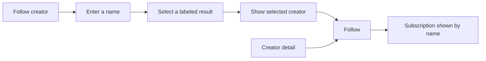

# Discord input discovery survey

Surveyed 2026-11-14 at `41a535bb9`. This is a source-code survey of production
Discord commands, their reachable workspaces, submission manifests, and shared
form and suggestion infrastructure. It is not a live Discord usability test;
priorities reflect the interaction cost visible in code, not measured usage.
Development-only layout demos and hidden owner commands are noted separately.

The recurring problem is that browsing and acting are disconnected. The bot
often knows the available objects, and sometimes already displays them, but a
form asks the person to identify the object again. Slash autocomplete covers
some entry points; opening the corresponding form loses that assistance.

The target should be: ordinary workflows can be completed by recognizing names,
choosing objects, and entering actual content. IDs remain useful in links,
diagnostics, and optional shortcuts. Query expressions remain available inside
search. Technical identifiers belong in specifically named reference or
maintenance tools.

## Implementation status

The five delivery stages below now have implementations. The inventory records
what was present at the survey revision; it is not a description of the current UI.

| Area | Implemented behavior |
| --- | --- |
| Starboards | Select a board once, then edit its settings, emoji aliases, and role weights. Channel and role inputs use native selectors; deletion requires confirmation. |
| Notifications | Search creators and records by name, or follow from their detail. Subscription labels resolve public names and all subscriptions are paged. Record-filter enums and tag values use typed choices. |
| Shared lookup | Enumerable catalogues support paging. Queried sources explicitly offer up to 25 matches and ask users to refine the search. Provider failures expose retry instead of appearing as empty results. |
| Tags and access | Choose a build/tag or a restriction before editing. Permission and internal-role pickers retain identities and expose operation-specific forms. Custom permission patterns act on the selected subject or role. |
| Search and records | Keyword input, removable filter rows, named values, and sort selection build queries while preserving advanced expressions. Maintenance tools select definitions, versions, and restrictions by name. |
| Submission and specialist tools | Credits use rows and a native Discord user picker while retaining identity evidence. Catalogue fields support name search without losing offscreen selections. Vote emojis and video activations use rows; ambiguous video inputs can be selected for retry. Conversion versions and runtime-setting names have discovery; numeric world-format versions are in Conversion maintenance. |

Each ordinary workflow has one editor. Query expressions live inside Search &
filters; custom wildcard patterns use a dedicated permission form. Credits have
an identity-reference form for Discord IDs or usernames, Java UUIDs, and Bedrock
XUIDs. The credit mini-language, compact video recipe, role-slug editor, and
standalone advanced-search form are removed from these Discord workspaces.
Exact record keys and numeric conversion versions are in maintenance tools.
Owner-only runtime JSON values remain available. New object names and slugs are
still entered when creating objects. Queried lookups are bounded search, not
exhaustive browsing of the entire domain.

Focused unit tests, rendered-control tests, and notification projection
integration tests cover the changed flows. The regression tests include
cross-page selections, duplicate labels, stale edits, authorization, query
grouping, credit evidence, vote identities, and video recipe retention. Live
Discord desktop/mobile usability and long-label locale checks remain rollout
work; automated payload checks do not substitute for them.

## Inventory

Priority 1 removes opaque identifiers from routine tasks. Priority 2 improves
search, structured data entry, and specialist tools. Priority 3 is operator or
polish work. Each row describes current behavior before proposing a change.

### Notifications

Sources: [notifications_view.py](../../squid/bot/notifications_view.py),
`NotificationSubscriptions`, and [notifications.py](../../squid/bot/notifications_cog.py).

| Input or action | Current discovery | Recommendation | Priority |
| --- | --- | --- | --- |
| Follow creator | Required **Creator profile ID** text field; handler insists on a UUID. | Search public creators by name, select a labeled result, and retain its public profile UUID internally. Add Follow to creator detail. | 1 |
| Follow record | Required **Record title ID** text field; also UUID-only. | Search stable record titles or follow directly from a record detail. Keep the stable title UUID, which survives rebuilds. | 1 |
| Follow matching records | Build kind, base title, and version scope are free text despite finite vocabularies. Showcase tag is a numeric ID; exact tag value is untyped text. | Named choices for enums; searchable tag selector; value control based on the selected tag's type; readable filter preview. | 1 |
| Inspect/unfollow subscriptions | Selector exists, but labels are just Creator/Record and descriptions expose subject UUIDs. Only the first 25 subscriptions are offered. | Resolve names and meaningful summaries, with pagination/search. A later subscription must be reachable without removing earlier ones. | 1 |
| Staff review DM | Provides a filled `/build browse id:…` instruction to copy; public notifications can include a website link. | Add a context-carrying Open build control for staff review, retaining visibility checks. | 2 |

Delivery preferences already use toggles. Inbox actions select existing items;
they do not require entering notification IDs. Their bounded listing is a
separate history/navigation limitation.

### Tags and restrictions

Sources: [admin.py](../../squid/bot/admin_cog.py), `tags_workspace`, and
[tags_view.py](../../squid/bot/tags_view.py).

| Input or action | Current discovery | Recommendation | Priority |
| --- | --- | --- | --- |
| `/tags build_id` | Optional build autocomplete. Omitting it opens the general workspace. | Keep the shortcut; add an entry from a selected build. | 1 |
| Apply showcase tag | Numeric tag ID and generic Value. General workspace also asks for build ID; a command-supplied build correctly removes that field. Catalogue shows tag names and IDs, but selecting a tag does not seed Apply. | Put Apply on tag detail, retain the current build when available, otherwise search for it. Render the selected tag's value type. | 1 |
| Add restriction alias | Requires a canonical restriction name in a plain text field. | Select the existing restriction; type only the new alias. | 1 |
| Propose tag | Display name, value-type choice, optional query-field name. | Keep name/type entry. Explain the optional query-field identifier, offer a generated default if valid, and expose editing it as advanced. | 2 |

Approve/reject/archive already act on the selected tag with confirmation. These
are examples of the contextual action pattern the contribution tools lack.

### Starboards

Source: [starboard/screen.py](../../squid/bot/starboard/screen.py).

| Input or action | Current discovery | Recommendation | Priority |
| --- | --- | --- | --- |
| Create | Free-text new name, numeric destination channel ID, numeric threshold. | Keep name/threshold; use a native channel selector restricted to eligible destinations. | 1 |
| Edit setting | Retype board name; select a setting; enter one generic text Value for every setting type, including channel IDs and booleans. | Select a board once; show the current value and a control appropriate to the setting. | 1 |
| Delete | Retype board name, then confirm. | Delete from the selected board's detail, preserving confirmation. | 1 |
| Edit emoji | Retype board name and emoji; operation/direction already have choices. | Retain board context. Select an existing emoji for removal; allow pasted emoji when adding. | 1 |
| Role weight | Retype board name and numeric role ID; empty multiplier removes the weight. | Native role selector; explicit Remove beside existing weights; numeric multiplier editor. | 1 |

The Boards tab already has a browser. Its detail currently only displays data;
the editing tabs do not inherit that selection. Channel validation in
`StarboardCog.starboard` must remain authoritative after adding native controls.

### Permissions and internal roles

Sources: [permissions.py](../../squid/bot/permissions_cog.py) and
[access_view.py](../../squid/bot/access_view.py).

| Input or action | Current discovery | Recommendation | Priority |
| --- | --- | --- | --- |
| `/access user/role` | Native Discord member/role arguments; defaults to the caller. | Keep. These are Discord roles, distinct from the internal roles below. | — |
| Direct rule | Permission pattern is plain text. Operation and scope are choices. A separate catalogue lists nodes and descriptions. | Search/select a permission with its description; a custom-pattern form for expressions outside the catalogue; preview the affected permissions. Revoke from an existing rule. | 1 |
| Assign/unassign internal role | Requires an internal role slug. | Search roles by display name, show slug/scope/rank as secondary detail. Unassign from existing assignments. | 1 |
| Edit internal role | Requires target slug plus **Pattern, included role, or rank**, whose meaning changes with operation. | Role-detail actions with separate permission, composed-role, and numeric-rank controls. Delete retains its confirmation. | 1 |
| Create internal role | Requires both display name and slug, plus rank/scope. | Derive a collision-checked slug from the name, with an advanced override. Explain rank before entry. | 2 |

The existing role and permission browsers supply much of the needed context.
Role composition must select an internal role, not a Discord role. Preserve
scope, delegation, rank, and revision checks in the application services.

### Build and record discovery

Sources: [commands.py](../../squid/bot/submission/commands.py),
[build_browse.py](../../squid/bot/submission/build_browse.py),
[search_help.py](../../squid/bot/submission/search_help.py), and
[search_view.py](../../squid/bot/submission/search_view.py).

| Input or action | Current discovery | Recommendation | Priority |
| --- | --- | --- | --- |
| `/search` | Required query with field/value autocomplete; sort autocomplete; explicit scope/matching choices. | Keep expert completion. Offer an empty-query entry to guided search so users can discover filters before typing syntax. | 2 |
| `/records query` | Optional text query with examples, but no autocomplete. No-argument entry already works. | Add appropriate record query suggestions; keep no-argument browsing. | 2 |
| `/build browse id` | Optional numeric ID with labeled build autocomplete; no-argument browser works. | Keep the optional direct shortcut and browse path. | — |
| Open by ID | Plain numeric modal alongside browsing/search. | Retain as a secondary shortcut; optionally accept supported build links. This is not a forced-ID workflow. | 3 |
| Search & filters | A query-language text field and a text sort field. Examples and a separate reference help; no structured filter editor. | Separate keyword entry from Add filter and Sort. Use labeled fields, operators, and value controls; retain advanced expression entry. | 2 |
| Record categories | Smallest/Fastest/First toggles and All standings are discoverable. Combined titles still need query syntax. | Keep toggles and add access to the other supported title types through named choices. | 2 |
| Search result actions | Result and holder selection avoids IDs. Search details mostly render cards; the catalogue's full build detail has richer management actions. | Share appropriate detail actions so selection can lead directly to edit, tag, or follow without restarting elsewhere. | 2 |

Search is not wholly undiscoverable: it has runnable examples, syntax guidance,
and scope-specific reference text. The remaining cost is learning syntax for
common tasks, especially after entering a modal. A filter builder should use
the actual field catalogue rather than duplicate the hand-authored reference.

### Record maintenance

Source: [records.py](../../squid/bot/submission/records.py), reached through
Record tools for authorized guild users.

| Input or action | Current discovery | Recommendation | Priority |
| --- | --- | --- | --- |
| Lookup category | Build-kind choice, **Definition ID or base key**, comma-separated restriction IDs, optional pinned version ID. | Separate selecting an existing definition from composing an exact category. Use named restrictions and versions. | 2 |
| Rebuild | Optional kind choice and numeric current-version ID. | Version picker with an explicit default/current option and a scope summary. | 2 |
| Evidence/title diagnostics | Named browsers show definition IDs; lookup is on another tab. | Add an action on the selected diagnostic, carrying its definition and kind. | 2 |

The lookup operation can materialize and recompute categories; it is not merely
a read. The UI should say so. A definition's integer ID, a category's base key,
and a subscription's stable record-title UUID are different identities. Do not
use one universal “record ID” picker for all three.

### Submission, saved-build editing, and schematics

Sources: [submit.py](../../squid/bot/submission/submit.py),
[sections.py](../../squid/bot/submission/ui/sections.py),
[forms.py](../../squid/submissions/application/forms.py),
[credit_text.py](../../squid/submissions/application/credit_text.py), and
[schematic_tools.py](../../squid/bot/submission/schematic_tools.py).

| Input or action | Current discovery | Recommendation | Priority |
| --- | --- | --- | --- |
| Submission slash options | Category/orientation choices; creators, versions, patterns, restrictions have autocomplete. Size and version-range syntax have examples. All options are optional. | Preserve this convenient entry and keep the guided draft as the complete path. | — |
| Draft/saved-build catalogue fields | Source/working versions, restrictions, patterns, and showcase tags use named selects paged in groups of 25. Selections survive page changes. | Reuse this implementation; add search to large option sets. These fields already avoid manual IDs. | 2 |
| Credits | Multiline mini-language: names or `discord:`, `java:`, `bedrock:` references with optional ` | role`. Existing typed credits can display subjects/IDs; unchanged entries preserve evidence. | A credit collection editor: identity kind, member/name lookup, role choice, add/remove. Preserve unresolved name-only credits and existing evidence. Use a structured identity-reference form for provider IDs outside the native picker. | 2 |
| Dimensions, timing, dates, links, location, proposals | Actual content entry, with helpers such as `5x7x4`, `30gt`, `15rt`, `1.5s`, and one entry per line. | Keep concise examples and units. These do not all need selectors; new restriction/pattern proposals must still allow new text. | — |
| Convert schematic | Format choices; optional numeric Minecraft data version and free-text release name, with explanatory help. | Named compatible release picker as the ordinary path; numeric data version belongs in Conversion maintenance. Distinguish this world-format number from the database version ID. | 2 |
| Render video | Motion choices and numeric duration/orbit; activations require `tick x y z` lines. Ambiguous inputs are returned as coordinates to re-enter. | Select detected inputs and edit activation timing as rows; allow explicit coordinates as advanced input. | 2 |

Draft selection, file controls, approval/rejection, build editing, and featured
schematic actions carry their object context already. They do not need new ID
fields. Credits need particular care: a public creator profile UUID, a linked
account, a Discord identity, and a name-only credit are not interchangeable.

### Account, settings, moderation, and remaining commands

| Surface | Current behavior and assessment | Recommendation |
| --- | --- | --- |
| `/account [user]` | Native user selector. Identity actions use selected identities. Profile editing uses text fields and a link collection editor. | Keep; add creator search for profiles that cannot conveniently be reached through a Discord user. |
| Account: claim creator credit | Plain creator-name form; no matching-name suggestions. | Search known credit names, show context, then submit a claim. Keep a route for names absent from the catalogue. Priority 2. |
| Account: link/merge | Manual in-game link and merge codes; merge-code creation is available in the workspace. | Keep code entry: these are possession proofs, not discoverable database references. Explain where the link code comes from. |
| Account: staff refresh/review | Refresh uses `EntityField`; claim review selects labeled claims and acts on them. | Reuse these patterns. |
| `/settings` | Channels use native selectors; language and vote kind use choices; role weights start from a role selector. | Keep. This is a model for starboard configuration. |
| Settings: voting emojis | Multiline `choice | emoji` syntax; choice names must be known. | Selected vote choice plus editable emoji rows; retain bulk input. Priority 2. |
| `/poll` | Guided wizard; question/options are content; options accept optional `emoji | label`; visibility/scope use choices and duration has examples. | Mostly appropriate. Consider a collection editor for options as polish. |
| `/versions` | Named catalogue browser and edition choice; adding a new version requires its name. | Keep free text for creating a new value. Add an example if needed. |
| `/recount message` | Requires a message link with clear option help. | A message-context action would remove copying; retain links as a useful shortcut. Priority 3. |
| Archive message → `/paste` | Message context menu carries the source; the destination is the channel where Paste runs. | Keep; this already eliminates source/destination ID entry. |
| Vote to Delete / Scan Build Message | Message context actions carry the selected message. | Keep. |
| `/errors [reference]` | Optional quoted error reference; no-argument browser is available. | Keep the reference shortcut. |
| `/redstoner` | Opens a configured role panel/deployment flow without raw identifier arguments. | No identifier-discovery change needed. |
| `/help [command]` | Grouped directory and command autocomplete. | Keep; replace placeholder option descriptions in `/access` and `/runtime-settings`. |
| `/runtime-settings` | Setting key, JSON value, optional revision; no suggestions. No arguments dumps settings/revision. JSON can include channel-ID arrays. | Operator priority 3: typed settings browser/editor, or at least setting-name completion, type hints, examples, and descriptions. |
| Hidden owner sync and development UI | Sync accepts guild objects and terse `~`, `*`, `^` flags. Layout demos are development-only; debug links/error triggers have no discovery need. | Document operator syntax locally; exclude from the ordinary-user redesign. |

Account/settings sources: [account_workspace.py](../../squid/bot/accounts/workspace.py),
[account_view.py](../../squid/bot/accounts/overview.py),
[profile_editor.py](../../squid/bot/accounts/profile_editor.py),
[settings_view.py](../../squid/bot/settings/screen.py). Remaining entries are rooted
in the production extension list in [app.py](../../squid/bot/app.py).

## Interaction design

Use the smallest control that expresses the task:

| What the user needs to supply | Preferred interaction |
| --- | --- |
| An object already being viewed | Carry its identity into a contextual action; do not ask again. |
| A Discord member, role, or channel | Native entity selector. |
| A small finite vocabulary | Labeled choice, radio group, or toggle. |
| An object in a large domain catalogue | Search by words, then select a labeled result. |
| Several existing objects | Searchable selection with a visible list of retained picks and individual removal. |
| New content or a new name | Text entry with a relevant example and validation. |
| A structured collection | Add/edit/remove rows with typed fields. |
| Query syntax, raw IDs, or bulk input | Purpose-specific query, reference, or maintenance controls. |

For example, Follow creator should work as follows. Searching and choosing are
separate interactions, but users never transcribe the UUID:

An ordinary low-impact follow need not gain a separate confirmation dialog.
The explicit Follow button can be on the result/detail itself. Destructive
actions should retain their existing confirmation and authorization checks.

### What Discord permits

The current component reference supports string, user, role, and channel
selects in modals. String selects contain at most 25 options. Consequently,
modal limitations do not justify asking for a channel snowflake or typing an
enum. See the official [component reference](https://docs.discord.com/developers/components/reference).

Text inputs have no custom autocomplete interaction. Application-command
autocomplete and modal submission are distinct interaction types. A modal
submit cannot directly open another modal, and a modal contains at most five
top-level components. A search submit should therefore update/show a message
with results; a subsequent selection or button can open the next form. See
Discord's [interaction reference](https://docs.discord.com/developers/interactions/receiving-and-responding).

Do not design a single modal whose later fields dynamically change when the
user selects an earlier field. Choose the object/setting on the message first,
then open its typed value form. This also gives room for explanations and
previews without overfilling the modal.

## Reuse and missing infrastructure

Most controls already exist. The main additions belong in feature workflows
and in a small adapter between domain lookups and shared widgets.

- [form_planning.py](../../packages/squid-ui-discord/src/squid_ui/ext/discord/form_planning.py)
  already renders choice, boolean, and native entity fields.
  [EntityField](../../packages/squid-ui-discord/src/squid_ui/ext/discord/form_fields.py)
  handles users, roles, channels, and mentionables. It currently lacks a
  channel-type filter property; use the message selector pattern from settings
  for restricted destinations, or extend that field deliberately.
- [SearchPicker](../../packages/squid-ui-widgets/src/squid_ui_widgets/search_picker.py)
  already supports search-then-select, retained picks, removal, and windowed
  results. No production `squid/bot` call site currently uses it. It needs a
  domain source and host-owned save/cancel behavior, not another widget rewrite.
- `Browser`, `MultiChoice`, and `CollectionEditor` already cover contextual
  detail, paged choices, and structured collections. The profile link editor
  demonstrates a collection editor; submission sections demonstrate retaining
  selections across pages.
- [The suggestion registry](../../squid/suggestions/infrastructure/catalogue.py)
  already provides `creator_profiles`, `record_titles`, `showcase_tag_ids`,
  `restriction_ids`, `permission_roles`, `permission_nodes`,
  `permission_patterns`, `starboard_names`, `version_ids`, `title_definitions`,
  `build_kinds`, `base_titles`, `version_scopes`, `search_fields`, and
  `search_sorts`. Bootstrap supplies the optional role/starboard services.
  These sources cover many identifiers currently typed into forms.

Two gaps need explicit treatment before adopting those sources broadly:

1. **Suggestions are not a paginated catalogue API.** Nonzero limits are capped
   at 25, and `SuggestionResult` has no cursor, total, or `has_more`. Enumerable
   public sources can be loaded completely and paged locally. Queried sources
   need a real windowed domain query for exhaustive browsing, or a clearly
   bounded “refine your search” picker. Do not invent a Next button over the same
   25 suggestions. Start with bounded search where appropriate and add paging
   where full reachability matters, especially subscription management.
2. **Autocomplete failure behavior is wrong for a persistent search screen.**
   `SuggestionService` returns an empty result for provider timeouts/failures,
   as well as some access/context failures. A picker must distinguish failed
   loading from a successful search with no matches. Add a suitable result
   contract or use a domain source that reports errors to the widget. Existing
   loading/retry controls cannot recover information the service discards.

For every lookup, carry locale, viewer, and required guild/category context;
keep pending/private visibility rules. Native selections and autocomplete
suggestions do not authorize a later write. Resolve the stored identity again
when applying it, recheck permission, and preserve the revision the user
actually edited. Offer a readable unavailable/deleted state instead of silently
substituting another object with the same name.

## Suggested delivery order

Implement this as independent changes with an observable completion condition:

1. **Starboards and finite choices.** Reuse settings' native channel/role
   controls, retain the selected board, and replace notification filter enums
   with choices. Add `/records` query suggestions and meaningful option help.
   This is the smallest useful slice and exercises no new large-catalogue API.
2. **Domain lookup and notifications.** Integrate `SearchPicker` with labeled,
   visibility-aware creator/record/tag sources; handle bounded results and
   failures honestly. Replace follow UUID forms, resolve subscription labels,
   and make every subscription reachable. Add contextual Follow actions.
3. **Tag and access workflows.** Apply tags from a build/tag detail, choose
   restrictions for aliases, and make role/rule editing act on selected
   objects. Split generic Value fields into operation-specific forms. Reuse
   existing service authorization and edit history.
4. **Guided search and record tools.** Introduce keyword input, filter rows, and
   sort choices. Render selected filters in plain language with individual
   removal. Scope available fields to builds or records. Keep advanced query
   entry; do not silently discard expressions the guided editor cannot
   represent. Separate definition selection from category construction and
   use named versions/restrictions in maintenance tools.
5. **Structured credits and specialist polish.** Add a credit collection editor
   without losing typed identity evidence. Improve video activations, voting
   emoji rows, large submission catalogues, and runtime-setting entry. Keep
   identity references and technical maintenance separate from ordinary entry.

Steps 1–3 address the sharpest identifier barriers. Step 4 is the larger search
design project and should not delay native selector fixes. There is no need to
move ordinary users to the website or rebuild the whole UI framework first.

## Acceptance and verification

The core acceptance test is behavioral: a person starting from an empty command
can follow a creator/record, apply a tag, configure a starboard, and assign a
role without obtaining an ID/slug elsewhere. Existing-object actions preserve
their context; creation, identity references, and maintenance identify why a raw
identifier is needed.

Test each changed flow with empty results, duplicate names, more than 25 items,
selection across pages/searches, a removed object, revoked permission, a stale
revision, retry, cancellation, and timeout where relevant. Check labels and
disambiguating details on mobile and in a long-label locale. Preserve other
answers when changing a selected object or correcting an invalid value.

For search, test that selected filters and advanced expressions retain their
meaning, including OR grouping and record visibility restrictions. For credits,
test that changing a role or adding another credit preserves the evidence of
unchanged entries. Native entity selection must still pass existing guild and
destination checks.

Before rollout, exercise representative flows in an actual Discord server on
desktop and mobile. No usage telemetry or live database catalogue sizes were
available for the source survey. The implementation status above records the
follow-up work and its remaining validation boundary.
